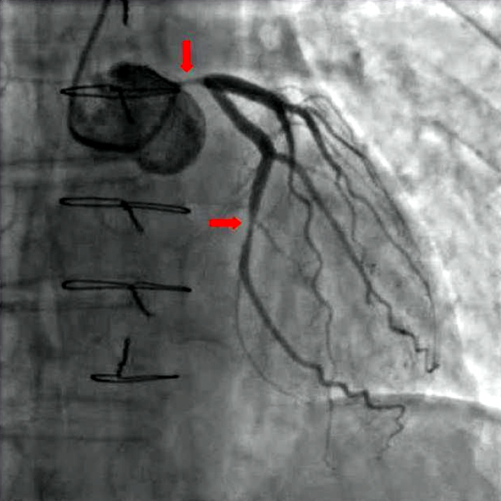
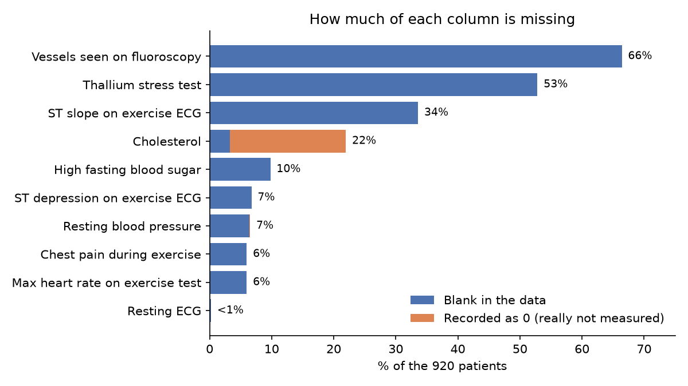
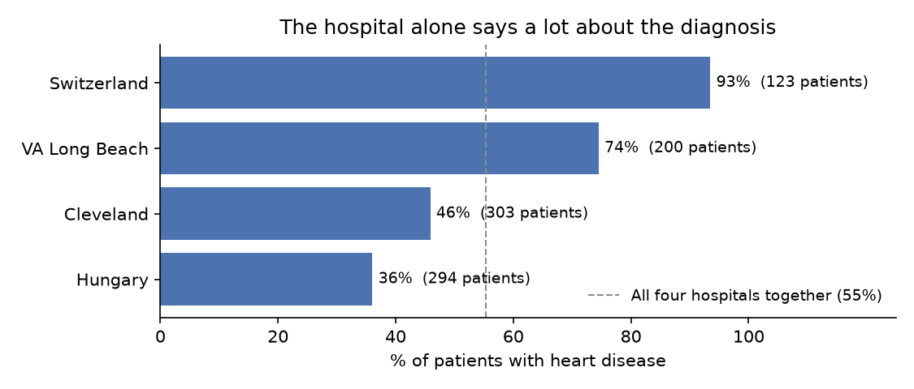
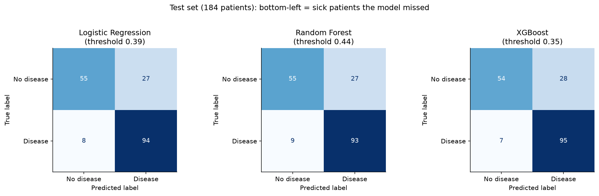
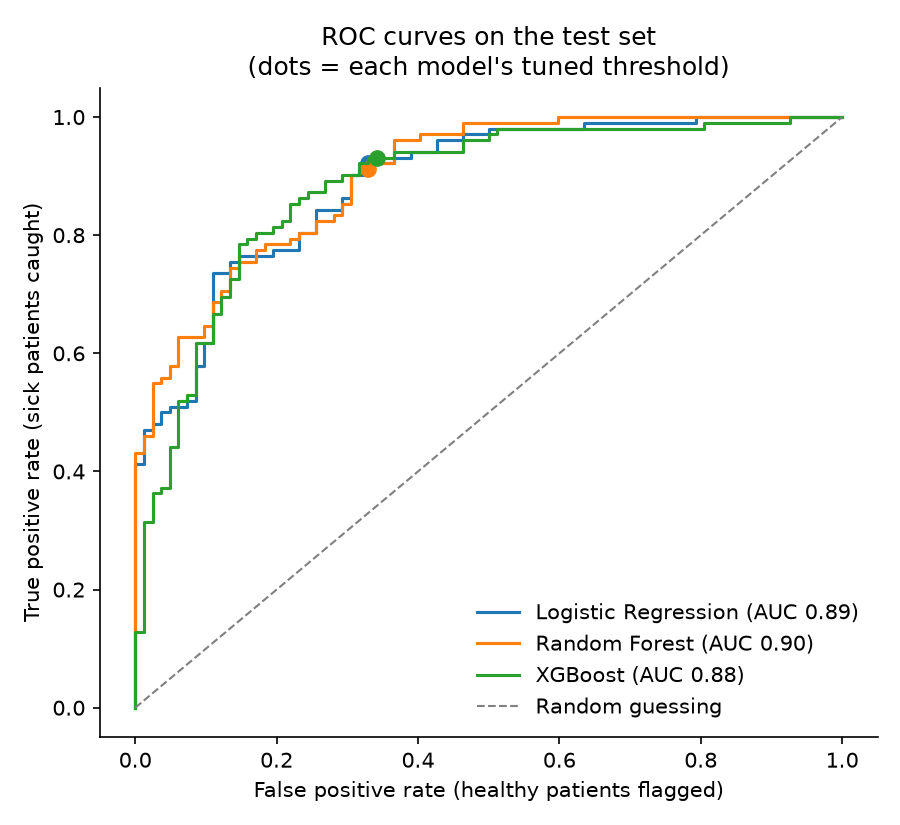
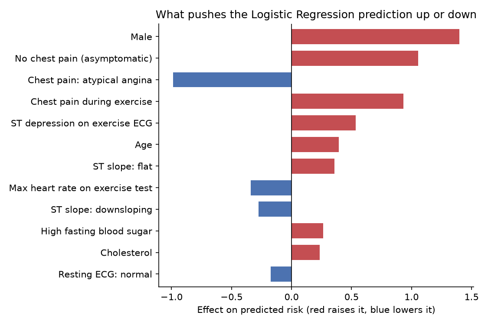
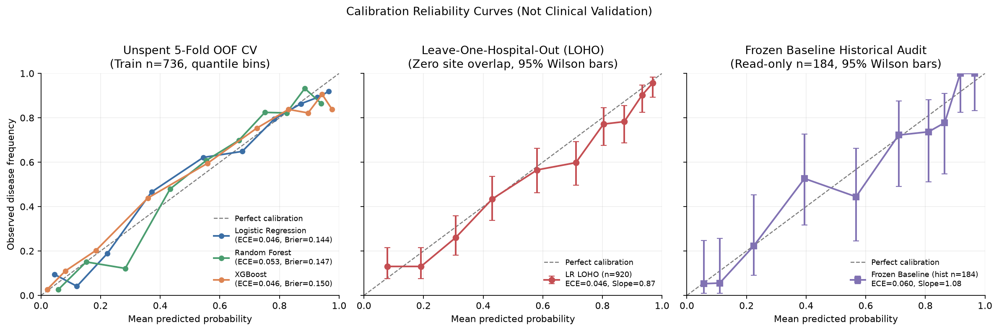
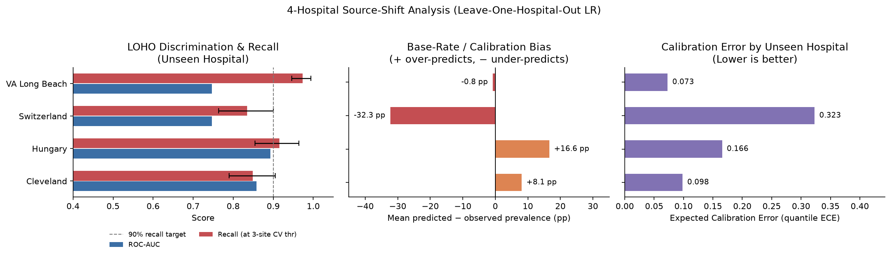
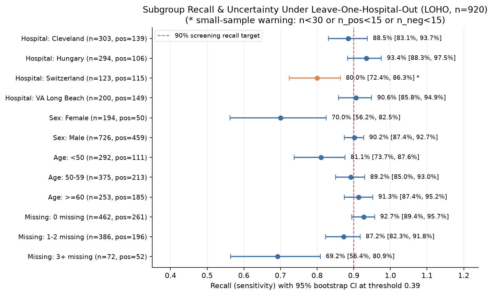
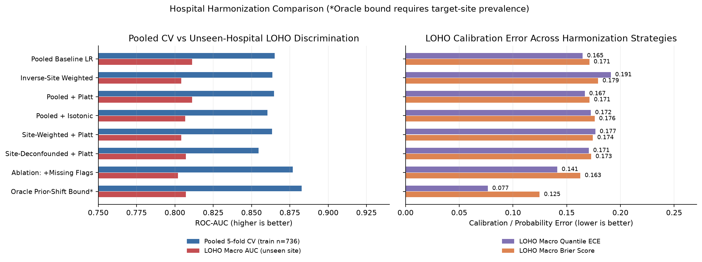

# Heart disease risk screen

A machine learning model that estimates whether a patient has heart disease from routine clinical
measurements: age, blood pressure, cholesterol, chest pain type, and an exercise ECG. I compared
logistic regression, random forest and XGBoost on 920 patients from four hospitals, tuned the model
so it misses as few sick patients as possible, and put it behind a small Streamlit app.

The question I kept coming back to: **if this were used for screening, which mistake is worse?**
Telling a sick patient they're fine is worse than a false alarm, because a false alarm just
means a follow-up test. So I didn't optimise for accuracy. I set the model up to catch at least 90%
of sick patients and then measured how many false alarms that costs.

## Case study: the 1989 paper behind the data



*A coronary angiogram: dye in the heart's arteries under X-ray, with arrows on the narrowed sections.
An example image, not a patient from this dataset. Image: Pantaleo et al., BMC Cancer 2012, 12:231,
[CC BY 2.0](https://creativecommons.org/licenses/by/2.0/), via
[Wikimedia Commons](https://commons.wikimedia.org/wiki/File:Angiography_coronary_stenosis_01.jpg).*

The data comes from one paper: Detrano et al., "International application of a new probability
algorithm for the diagnosis of coronary artery disease", *American Journal of Cardiology*, 1989
([doi:10.1016/0002-9149(89)90524-9](https://doi.org/10.1016/0002-9149(89)90524-9)).

The authors built a model on 303 patients at the Cleveland Clinic that turned clinical measurements
and non-invasive test results into a probability of coronary disease. Then they tried it on patients
at three other sites: Budapest, Long Beach, and Zurich and Basel. It overestimated disease in Budapest
and Long Beach (by about 10 and 5 percentage points on average) and underestimated it in the Swiss
group (by about 7). The measurements were the same. The hospital had changed.

Every patient in the study had a coronary angiogram, and that reading is the label: a patient counts
as having disease when a major artery is narrowed by more than half its diameter.

Two things in this project follow from that paper:

- **The hospital is part of the answer, so the model is not allowed to see it.** The paper's model
  shifted from site to site. In this data the share of patients with disease also differs a lot by
  hospital, so I dropped the hospital column (see below).
- **These are patients someone already sent for an angiogram.** That is a sicker group than the
  general population, which is the first item under Limitations.

## What I found in the data

Before modelling anything I spent time just looking at the dataset, and it was messier than I
expected.



- **Two columns are mostly empty.** `ca` (blood vessels seen on fluoroscopy) is missing for 66% of
  patients and `thal` (thallium stress test) for 53%. Both come from expensive tests that only the
  Cleveland hospital ran on most patients. Filling in two thirds of a column would mean inventing
  the data, so I dropped both.
- **Some missing values were hiding as zeros.** 172 patients have a cholesterol of exactly 0, which
  isn't possible for a living person. Someone entered 0 for "not measured." `isna()` doesn't catch
  these, so cholesterol looks 3% missing but is really 22% missing. I convert them to proper
  missing values before training.



- **The hospital is a shortcut the model shouldn't take.** 93% of the Swiss patients have heart
  disease, compared with 36% in Hungary. If the model could see which hospital a patient came from,
  it would lean on that instead of the patient's actual measurements, and a new patient doesn't
  come from any of these four hospitals anyway. So the `dataset` column is dropped.

## Results

The data was split once, 80/20, at the start. All tuning happened with 5-fold cross-validation on
the 736 training patients. The 184 test patients were only used once, at the very end, for the
numbers below.

| Model | Threshold | Accuracy | Precision | Recall | ROC-AUC | Sick patients missed | False alarms |
|---|---|---|---|---|---|---|---|
| Logistic Regression | 0.50 | 0.79 | 0.80 | 0.84 | 0.89 | 16 | 22 |
| **Logistic Regression** | **0.39** | **0.81** | **0.78** | **0.92** | **0.89** | **8** | **27** |
| Random Forest | 0.50 | 0.79 | 0.78 | 0.87 | 0.90 | 13 | 25 |
| Random Forest | 0.44 | 0.80 | 0.78 | 0.91 | 0.90 | 9 | 27 |
| XGBoost | 0.50 | 0.81 | 0.80 | 0.87 | 0.88 | 13 | 22 |
| XGBoost | 0.35 | 0.81 | 0.77 | 0.93 | 0.88 | 7 | 28 |



What I took away from this:

- **Lowering the threshold mattered more than the choice of model.** For logistic regression,
  moving the cut-off from 0.50 to 0.39 halved the number of missed sick patients (16 to 8) and
  added only 5 false alarms.
- **The fancy models didn't buy much.** All three land within a couple of points of each other.
  On 920 patients there just isn't enough data for random forest or XGBoost to pull ahead, and
  logistic regression is much easier to explain.
- **I picked the final model before looking at the test set.** The rule was: among the models tuned
  to 90% recall in cross-validation, take the one with the fewest false alarms. Logistic regression
  won. XGBoost happens to miss one fewer patient on the test set, but switching to it *because* of
  the test set would make the test set useless as an honest check.



## What the model pays attention to



Being male, chest pain during exercise, and ST depression on the exercise ECG all push the risk up,
which matches what I read about heart disease. The one that surprised me was **"no chest pain
(asymptomatic)"** being one of the strongest risk signals. These patients were all referred for an
angiogram, so someone with no chest pain who still got referred probably had other warning signs.
It's a good reminder that the model learns patterns in *this* group of patients, not medical truth.

## How it handles missing values without cheating

Missing values are filled in (median for numbers, most common value for categories) and features
are scaled inside a scikit-learn `Pipeline`. That way the fill-in values are learned from the
training data only. If I had filled them in using the whole dataset first, a little information
about the test patients would leak into training and the results would look better than they
really are.

## Statistical deepening: calibration, 4-hospital source shift, and harmonization

A single headline recall (`92.2%` on `184` test patients, `102` positive cases) hides finite-sample uncertainty, cross-hospital calibration shift, and subgroup disparities. The statistical deepening suite ([`src/statistics.py`](src/statistics.py), [`src/harmonization.py`](src/harmonization.py), full report in [`reports/STATISTICAL_REPORT.md`](reports/STATISTICAL_REPORT.md)) audits the **frozen baseline** (`models/heart_model.joblib`, SHA-256 verified untouched) read-only and evaluates all new calibration/harmonization candidates strictly on **unspent 5-fold CV inside the 736 training rows** and **zero-hospital-overlap Leave-One-Hospital-Out (LOHO) CV** across all four sites (`n=920`, `B=2000` bootstrap draws, `seed=42`).

*This is statistical auditing on archival 1981–1988 angiography data, **not** clinical validation.*

| Evaluation regime | Grouping | n (pos) | Recall (95% bootstrap CI) | Precision (95% CI) | ROC-AUC (95% CI) | Quantile ECE | Brier |
|---|---|---:|---|---|---|---|---|
| **Frozen Baseline (Historical Audit, Read-Only)** | Row-stratified (4 sites mixed) | 184 (102) | 92.2% [86.7%, 97.0%] | 77.7% [69.9%, 85.1%] | 0.889 [0.842, 0.931] | 0.060 | 0.135 |
| **Unspent 5-Fold OOF CV (Train only, LR)** | Row-stratified inside train | 736 (407) | 90.2% [87.2%, 92.9%] | 77.6% [73.8%, 81.1%] | 0.865 [0.836, 0.891] | 0.046 | 0.144 |
| **Leave-One-Hospital-Out (LOHO, LR @ 0.39)** | Hospital-grouped (zero site overlap) | 920 (509) | 88.2% [85.3%, 90.9%] | 72.1% [68.5%, 75.4%] | 0.835 [0.808, 0.860] | 0.046 | 0.166 |






Key statistical findings:
- **Wide finite-sample recall interval**: On `102` positive test patients, `92.2%` recall spans **`[86.7%, 97.0%]`** (bootstrap) / **`[85.3%, 96.0%]`** (exact Wilson) — over 10 percentage points wide.
- **Cross-hospital base-rate shift reproduces Detrano et al. (1989)**: Under zero-overlap LOHO, the model over-predicts disease in Hungary (`+16.6 pp`, ECE `0.166`) and Cleveland (`+8.1 pp`, ECE `0.098`), and severely under-predicts in Switzerland (`-32.3 pp`, ECE `0.323`, where prevalence is `93.5%` and cholesterol is `100%` missing).
- **Subgroup disparities under LOHO (threshold 0.39)**: Female recall drops to **`70.0% [56.2%, 82.5%]`** vs Male **`90.2% [87.4%, 92.7%]`** despite near-identical ROC-AUC (`0.812` vs `0.805`) due to lower base rate and sex coefficient offset. Patients with **3+ missing features** drop to **`69.2% [56.4%, 80.9%]`** recall and `0.185` ECE vs `92.7%` recall with 0 missing fields.
- **Stealth missingness-proxy leakage proved**: Adding missingness indicators (`add_indicator=True`) boosts pooled Train CV AUC from `0.8651` to `0.8769` (`+1.2 pp`), **but drops unseen-hospital LOHO Macro AUC from `0.8112` to `0.8020` (`-0.9 pp`)**, because missingness patterns (`chol` missing 100% in Switzerland; `slope` missing 65% in Hungary) act as a stealth hospital-ID proxy.
- **Harmonization & Bayes prior-shift decomposition**: Site-deconfounded IPW + out-of-fold Platt scaling achieves the lowest unspent Train CV ECE (`0.0388` vs `0.0463`), saved separately as versioned candidate `models/candidates/harmonized_calibrated_lr_v1.joblib`. Applying a 1-parameter Bayes prior-odds intercept adjustment to a target site's known prevalence cuts unseen-hospital LOHO Macro ECE by **55%** (`0.1706` to `0.0767`) and Macro Brier from `0.1728` to `0.1248`, proving that site base-rate shift—not feature slope—drives most cross-hospital miscalibration.

## Product API, privacy boundary, and synthetic-only Meta assistant

In addition to the hardened Streamlit prototype ([`app.py`](app.py)), [`product/api.py`](product/api.py) provides a hardened FastAPI backend + offline static frontend (`product/static/`):

- **Strict validation & session hygiene**: Pydantic v2 schemas (`src/schemas.py`) enforce physiological bounds, reject sentinel zeros (`chol=0`/`trestbps=0`), reject `NaN`/`Inf`, reject hospital IDs (`dataset`), and block personal identifiers (`patient_name`, `mrn`, `email`, `ssn`, etc.). API routes set `Cache-Control: no-store` and never log or persist patient inputs. Error handlers redact tokens, secrets, and private filesystem paths (`src/security.py`).
- **Honest per-patient uncertainty**: Every prediction pairs the frozen baseline (`models/heart_model.joblib`, threshold `0.39`) with a 95% bootstrap epistemic interval from a separately versioned ensemble (`models/candidates/uncertainty_bootstrap_v1.joblib`, `B=200` training resamples), missing-field imputation warnings, exact log-odds feature contributions, and the harmonized calibrated reference probability.
- **Informational assistant layer (`src/assistant.py`, `src/meta_client.py`, `src/meta_ledger.py`)**:
  - **Local offline mode (`use_external_meta_api=false`)**: Runs 100% locally in Python with zero network calls for any validated de-identified measurement set.
  - **Metered Meta API adapter (`use_external_meta_api=true`)**: Strictly enforced in code to accept **registered SYNTHETIC archetype profiles only** (`SYNTH-001`–`SYNTH-006`, verified by SHA-256 digest in `src/synthetic_profiles.py`). Real or custom patient data is refused before any payload is built.
  - **No free text on the external path**: the external adapter only accepts one of the canonical question templates in `EXTERNAL_QUESTION_TEMPLATES` (`src/schemas.py`); a typed question could carry real patient details, so free-text questions are answered by the local offline path only. As a second layer, `MetaAssistantClient` scans every outgoing message for PII patterns (emails, phone numbers, dates, record numbers, names, addresses), secrets, and private paths, and refuses without echoing what it found.
  - **Output gate**: any external reply containing diagnostic verdicts, "you are healthy"-style reassurance, discouraging clinical follow-up, or medication/treatment instructions is withheld in full and replaced by the deterministic local explanation.
  - **Shared spend guards**: the API server uses one `MetaAssistantClient` (one spend run) for all requests, so the per-run cap applies across HTTP requests. Each live call atomically checks every cap and records a worst-case hold under the ledger lock (`<ledger>.holds.json`), so concurrent threads, client instances, and processes cannot overspend; the hold becomes a real charge in the same locked step, and holds left behind by a crashed process expire into worst-case charges.
  - **Spend honesty & replay-first**: Defaults to `HEART_ASSISTANT_MODE=replay` ($0.00 spend against explicitly labeled offline schema replay stubs in `fixtures/recorded/`). Live/record calls (`https://api.meta.ai/v1`, Standard-mode `muse-spark-1.3`, ~$0.002/call worst-case) stay refused until an operator sets `HEART_ASSISTANT_MODE=live` (or `record`), `HEART_LIVE_CLEARED=1`, and `MODEL_API_KEY`, with worst-case reserve-before-call checks and a hash-chained JSONL spend ledger. Live Meta API runs remain **unverified** until executed with operator credentials.

## Run it yourself

```bash
python -m venv .venv
source .venv/bin/activate          # Windows: .venv\Scripts\activate
pip install -r requirements.txt

python data/download_data.py       # downloads the UCI data into data/
python -m src.explore              # data report + the two data charts
python -m src.harmonization        # trains versioned candidates in models/candidates/ (baseline untouched)
python -m src.statistics           # calibration, LOHO source shift, subgroups, bootstrap CIs
pytest -v                          # full test suite (baseline integrity, stats, privacy, ledger, API)

uvicorn product.api:app --port 8000  # FastAPI + static UI product app
streamlit run app.py                 # Streamlit prototype UI
```

## Using the app

`streamlit run app.py` opens the app in the browser. Fill in the patient's details and press
**Estimate risk**.

- **Any field can be left as "Unknown".** Tick the *Unknown* box next to a measurement, or pick it
  from the menu, when a value wasn't taken. The model fills it in with the median or most common
  value from the training patients, the same way it filled gaps in the original data.
- **Read the result as a probability, not a verdict.** The app shows the estimated chance of heart
  disease and flags the patient when it reaches 0.39, the cut-off chosen to catch about 9 in 10
  sick patients. "Not flagged" means below that line, not "healthy."
- **It's a prototype.** It was trained on 920 patients referred for angiography between 1981 and
  1988, so treat the number as a demonstration of the modelling, not a reading of a real patient.

## Limitations

- The data is from 1981 to 1988, and every patient had already been referred for an angiogram.
  That's not the general population, so the model would likely over-predict disease for, say, a
  healthy 30-year-old.
- 184 test patients is a small test set. Each number in the table could easily move a few
  percentage points with a different split.
- Not a medical device, and not medical advice.

## Data

Janosi, A., Steinbrunn, W., Pfisterer, M., & Detrano, R. (1988). Heart Disease [Dataset].
UCI Machine Learning Repository. https://doi.org/10.24432/C52P4X
