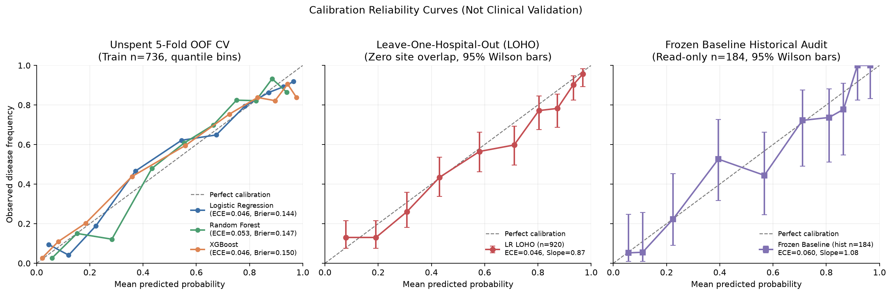
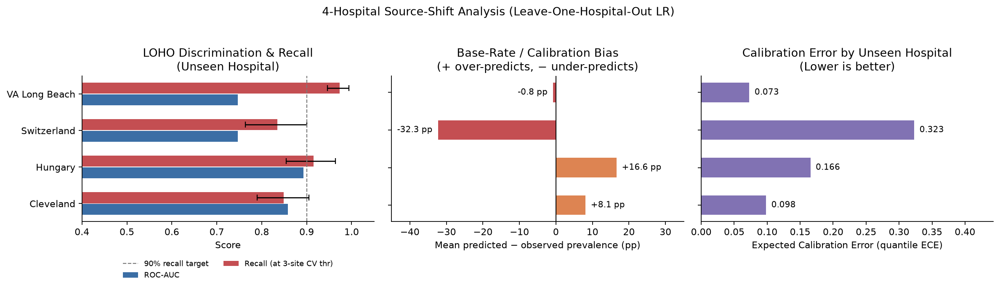
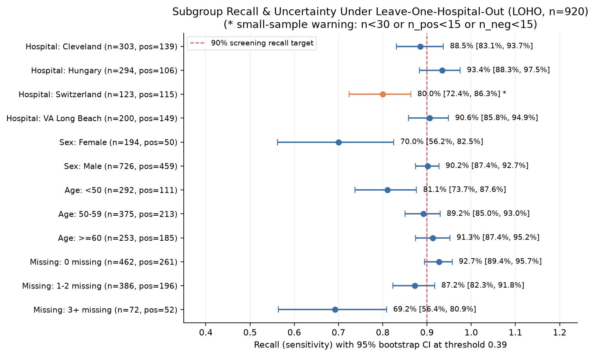
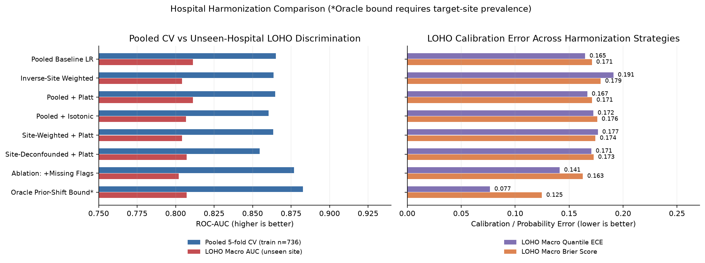

# Statistical Deepening Report: Calibration, Source Shift, Harmonization & Uncertainty

> **Disclaimer**: Statistical audit of archival 1981-1988 angiography-referral patients. This is NOT clinical validation and NOT a medical device.

## Provenance & Evaluation Discipline
- **Generated (UTC)**: `2026-11-22T20:04:27+00:00`
- **Dataset**: UCI Heart Disease (Janosi et al. 1988 / Detrano et al. 1989; CC BY 4.0) (`n=920`, SHA-256 `a5e3e9a0cf2728aa...`)
- **Frozen baseline artifact**: `models/heart_model.joblib` (threshold `0.39`, SHA-256 `aa7f0be5903c16ce...`, scikit-learn `1.7.2`) — verified untouched before and after.
- **Bootstrap**: `B=2000` nonparametric draws, `seed=42`.
- **Reproduce**: `python -m src.statistics`
- **Split & leakage policy**: All model/calibration/harmonization comparisons use unspent 5-fold nested CV on n=736 training rows and zero-hospital-overlap Leave-One-Hospital-Out (LOHO) CV on all 4 hospitals. The historical n=184 test split is audited read-only for the already-frozen baseline artifact and is never used for tuning, calibration, or selection.

## 1. Headline Recall & Calibration with 95% Bootstrap Confidence Intervals

Turning the single historical point estimate (`92.2%` recall on `n=184`, `102` positive patients) into honest uncertainty intervals:

| Evaluation Regime | Grouping | n (pos) | Recall (95% CI) | Precision (95% CI) | ROC-AUC (95% CI) | Quantile ECE | Brier | CITL | Cal Slope |
|---|---|---:|---|---|---|---|---|---|---|
| **Frozen Baseline (Historical Audit, Read-Only)** | Row-stratified (all 4 sites mixed) | 184 (102) | 92.2% [86.7%, 97.0%] | 77.7% [69.9%, 85.1%] | 0.889 [0.842, 0.931] | 0.060 | 0.135 | -0.05 | 1.08 |
| **Unspent 5-Fold OOF CV (Train only, LR)** | Row-stratified inside train | 736 (407) | 90.2% [87.2%, 92.9%] | 77.6% [73.8%, 81.1%] | 0.865 [0.836, 0.891] | 0.046 | 0.144 | +0.00 | 0.93 |
| **Leave-One-Hospital-Out (LOHO, LR @ 0.39)** | Hospital-grouped (zero site overlap) | 920 (509) | 88.2% [85.3%, 90.9%] | 72.1% [68.5%, 75.4%] | 0.835 [0.808, 0.860] | 0.046 | 0.166 | -0.23 | 0.87 |

Analytical Wilson 95% CI cross-check on frozen baseline historical recall: `85.3%` to `96.0%` (closely agrees with bootstrap `86.7%` to `97.0%`).

## 2. 4-Hospital Source Shift (Dataset Shift & Leave-One-Hospital-Out)

| Held-Out Hospital | n (prev) | Train prev | CV thr | LOHO Recall (95% CI) | LOHO Precision | LOHO ROC-AUC | Prob Bias (pp) | Quantile ECE | CITL |
|---|---:|---:|---:|---|---|---|---|---:|---:|
| Cleveland | 303 (45.9%) | 60.0% | 0.46 | 84.9% [79.0%, 90.5%] | 67.4% | 0.858 [0.815, 0.899] | +8.1 pp | 0.098 | -0.53 |
| Hungary | 294 (36.0%) | 64.4% | 0.46 | 91.5% [85.4%, 96.4%] | 63.4% | 0.893 [0.847, 0.929] | +16.6 pp | 0.166 | -1.19 |
| Switzerland | 123 (93.5%) | 49.4% | 0.35 | 83.5% [76.3%, 90.0%] | 97.0% | 0.747 [0.499, 0.958] | -32.3 pp | 0.323 | +2.92 |
| VA Long Beach | 200 (74.5%) | 50.0% | 0.33 | 97.3% [94.6%, 99.4%] | 80.1% | 0.747 [0.662, 0.827] | -0.8 pp | 0.073 | +0.06 |

## 3. Subgroup Analysis (Leave-One-Hospital-Out LR @ threshold 0.39, n=920)

| Dimension | Subgroup | n (pos) | Recall (95% CI) | Precision | Specificity | ROC-AUC | Quantile ECE | Note |
|---|---|---:|---|---|---:|---:|---:|---|
| hospital | Cleveland | 303 (139) | 88.5% [83.1%, 93.7%] | 63.7% | 57.3% | 0.858 | 0.098 |  |
| hospital | Hungary | 294 (106) | 93.4% [88.3%, 97.5%] | 59.3% | 63.8% | 0.893 | 0.166 |  |
| hospital | Switzerland | 123 (115) | 80.0% [72.4%, 86.3%] | 96.8% | 62.5% | 0.747 | 0.323 | Small sample (interpret cautiously) |
| hospital | VA Long Beach | 200 (149) | 90.6% [85.8%, 94.9%] | 80.4% | 35.3% | 0.747 | 0.073 |  |
| sex | Female | 194 (50) | 70.0% [56.2%, 82.5%] | 53.8% | 79.2% | 0.812 | 0.095 |  |
| sex | Male | 726 (459) | 90.2% [87.4%, 92.7%] | 74.2% | 46.1% | 0.805 | 0.044 |  |
| age_band | <50 | 292 (111) | 81.1% [73.7%, 87.6%] | 62.5% | 70.2% | 0.846 | 0.071 |  |
| age_band | 50-59 | 375 (213) | 89.2% [85.0%, 93.0%] | 71.7% | 53.7% | 0.811 | 0.059 |  |
| age_band | >=60 | 253 (185) | 91.3% [87.4%, 95.2%] | 79.0% | 33.8% | 0.784 | 0.057 |  |
| missingness | 0 missing | 462 (261) | 92.7% [89.4%, 95.7%] | 72.0% | 53.2% | 0.871 | 0.081 |  |
| missingness | 1-2 missing | 386 (196) | 87.2% [82.3%, 91.8%] | 70.7% | 62.6% | 0.815 | 0.066 |  |
| missingness | 3+ missing | 72 (52) | 69.2% [56.4%, 80.9%] | 80.0% | 55.0% | 0.735 | 0.185 |  |
| chest_pain | asymptomatic | 496 (392) | 95.9% [94.0%, 97.8%] | 80.0% | 9.6% | 0.711 | 0.081 |  |
| chest_pain | typical angina | 46 (20) | 80.0% [62.5%, 95.2%] | 50.0% | 38.5% | 0.564 | 0.281 |  |
| chest_pain | atypical angina | 174 (24) | 41.7% [21.1%, 61.1%] | 35.7% | 88.0% | 0.705 | 0.096 |  |
| chest_pain | non-anginal | 204 (73) | 64.4% [53.6%, 75.4%] | 50.5% | 64.9% | 0.734 | 0.102 |  |

## 4. Hospital Harmonization & Stealth Missingness-Proxy Ablation

| Strategy | Inference Site-ID Free? | Nested Train CV AUC (n=736) | Nested Train CV ECE | LOHO Macro AUC | LOHO Macro ECE | LOHO Macro Brier | LOHO Pooled ECE |
|---|---|---:|---:|---:|---:|---:|---:|
| Pooled Baseline LR (unweighted, uncalibrated) | Yes | 0.8651 | 0.0463 | 0.8112 | 0.1649 | 0.1711 | 0.0459 |
| Inverse-Site-Weighted LR | Yes | 0.8637 | 0.0490 | 0.8041 | 0.1911 | 0.1793 | 0.0891 |
| Pooled LR + OOF Platt Scaling | Yes | 0.8647 | 0.0465 | 0.8112 | 0.1669 | 0.1713 | 0.0444 |
| Pooled LR + OOF Isotonic Calibration | Yes | 0.8603 | 0.0428 | 0.8067 | 0.1724 | 0.1761 | 0.0801 |
| Inverse-Site-Weighted LR + OOF Platt | Yes | 0.8635 | 0.0411 | 0.8041 | 0.1767 | 0.1744 | 0.0509 |
| Site-Deconfounded IPW LR + OOF Platt | Yes | 0.8547 | 0.0388 | 0.8071 | 0.1706 | 0.1728 | 0.0393 |
| Ablation: Pooled LR + Missingness Indicators (Stealth Site-Proxy Test) | Yes | 0.8769 | 0.0394 | 0.8020 | 0.1413 | 0.1628 | 0.0452 |
| Diagnostic Bound: Site-Deconfounded Platt + Target-Site Prevalence Recalibration | No (diagnostic bound) | 0.8827 | 0.0384 | 0.8071 | 0.0767 | 0.1248 | 0.0496 |

